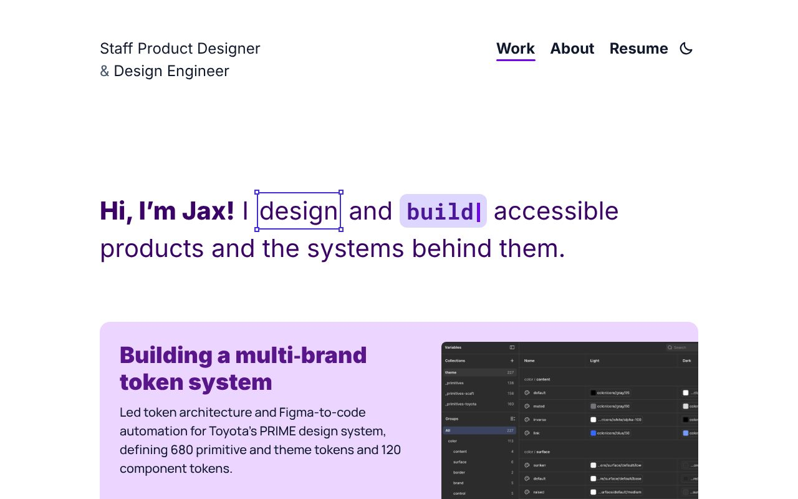

# Jax Engel portfolio

Source for [jaxengeldesign.com](https://jaxengeldesign.com): a staff product designer's portfolio with case studies, an About page and a resume. React 19, TypeScript, Vite, CSS modules and React Router, deployed to GitHub Pages.



## Run it

```bash
npm ci
npm run dev
```

Other commands: `npm run build` (production build plus per-route meta), `npm run preview`, `npm run lint` (ESLint with `jsx-a11y`), `npm run typecheck`, `npm run format`, `npm run build:theme` (regenerates `src/styles/theme.css` from `src/tokens`). CI runs lint, typecheck and build on every pull request.

## What to look at

- **Accessibility.** Semantic headings, visible focus, focus moved to the `h1` on route change, forced-colors outlines, reduced-motion handling and `jsx-a11y` linting.
- **Design tokens.** One TypeScript source compiles to light and dark CSS custom properties. Components read only those tokens.
- **Performance and SEO.** Self-hosted fonts, image sizes read from the files, and per-route meta written at build time.

## How it is built

Design tokens in `src/tokens` compile to CSS custom properties, and components are CSS modules that read only those tokens. `CLAUDE.md` holds the working rules and conventions, `docs/decisions.md` the reasons behind them and `docs/plan.md` where the project stands.

## License

The code here is under the [MIT License](LICENSE).
